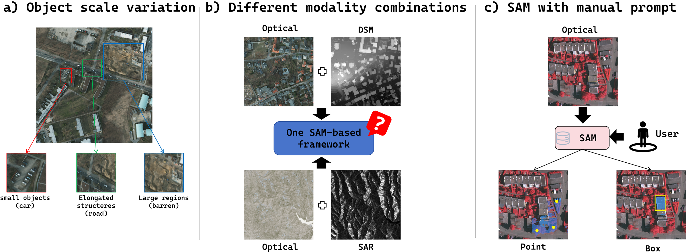
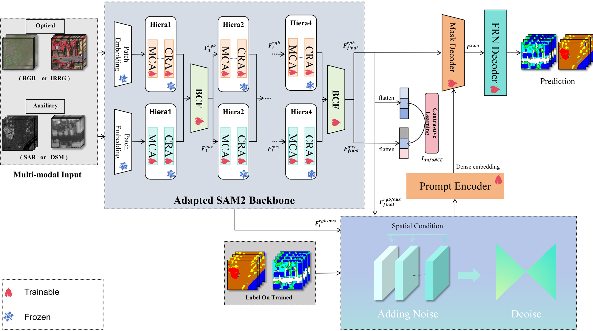

# MAP-SAM

Code for the paper **MAP-SAM: A Framework for Multimodal Remote-Sensing Semantic Segmentation Based on Modality Adaptation and Diffusion Prompt Generation**. This repository provides the C1 implementation for optical–DSM segmentation on ISPRS Vaihingen.

## Challenges

Applying SAM to remote sensing requires representing land-cover objects at different scales, combining optical imagery with auxiliary observations such as DSM or SAR, and generating segmentation prompts automatically.

## Framework

MAP-SAM uses a shared, frozen SAM 2 encoder with modality-specific adapters and bidirectional fusion. A cross-modal contrastive constraint aligns features during training. The diffusion module generates dense prompts from both modalities to guide semantic decoding.

## Dataset and setup

Use Python 3.10 or later. Install [PyTorch and torchvision](https://pytorch.org/get-started/locally/) for your device, then run:

~~~bash
pip install -r requirements.txt
~~~

Download the original [SAM 2 Hiera-S checkpoint](https://github.com/facebookresearch/sam2#sam-2-checkpoints), named `sam2_hiera_small.pt`. Prepare aligned 1024 × 1024 TIFF tiles from the [ISPRS Vaihingen benchmark](https://www.isprs.org/resources/datasets/benchmarks/UrbanSemLab/2d-sem-label-vaihingen.aspx):

~~~text
Vaihingen-1024/
  train/{img,dsm,gray_label}/
  val/{img,dsm,gray_label}/
  test/{img,dsm,gray_label}/
~~~

Match tile filenames across the optical, DSM, and label folders. Use [class IDs 0–5](MAP-SAM/utils/classes.json) for labels and `255` for ignored pixels. The C1 setup uses 136 training, 38 validation, and 36 test tiles.

## Training

Run from the repository root, replacing the example paths:

~~~bash
python MAP-SAM/train.py --root /path/to/Vaihingen-1024 --sam-checkpoint /path/to/sam2_hiera_small.pt --output runs/vaihingen-c1
~~~

Training uses batch size 2, seed 42, and up to 100 epochs. The checkpoint with the highest validation foreground mIoU is saved as `best.pth`. An existing `last.pth` in the output folder resumes training. Training and validation use 10 DDIM steps. The release trainer disables AMP weight caching so the supervised diffusion pass retains its gradients, which can change the outcome of a new run relative to the archival C1 run.

## Testing

~~~bash
python MAP-SAM/test.py --root /path/to/Vaihingen-1024 --sam-checkpoint /path/to/sam2_hiera_small.pt --checkpoint runs/vaihingen-c1/best.pth --output runs/vaihingen-c1/test
~~~

Testing uses five DDIM steps by default and exports grayscale masks, a confusion matrix, and IoU, F1, and overall accuracy. Use `--ddim-steps 10` for the archival C1 setting or `--device cpu` for CPU execution.

## Acknowledgments

We thank the [GeoSAM authors](https://github.com/110-011/GeoSAM) for the diffusion prompting implementation on which this work builds, [Meta SAM 2](https://github.com/facebookresearch/sam2) for the backbone, and [ISPRS](https://www.isprs.org/resources/datasets/benchmarks/UrbanSemLab/2d-sem-label-vaihingen.aspx) for the Vaihingen benchmark. The [SAM 2 license](MAP-SAM/model/SAM2/LICENSE) and [SegFormer license](third_party/SegFormer-LICENSE.txt) accompany the corresponding components.
